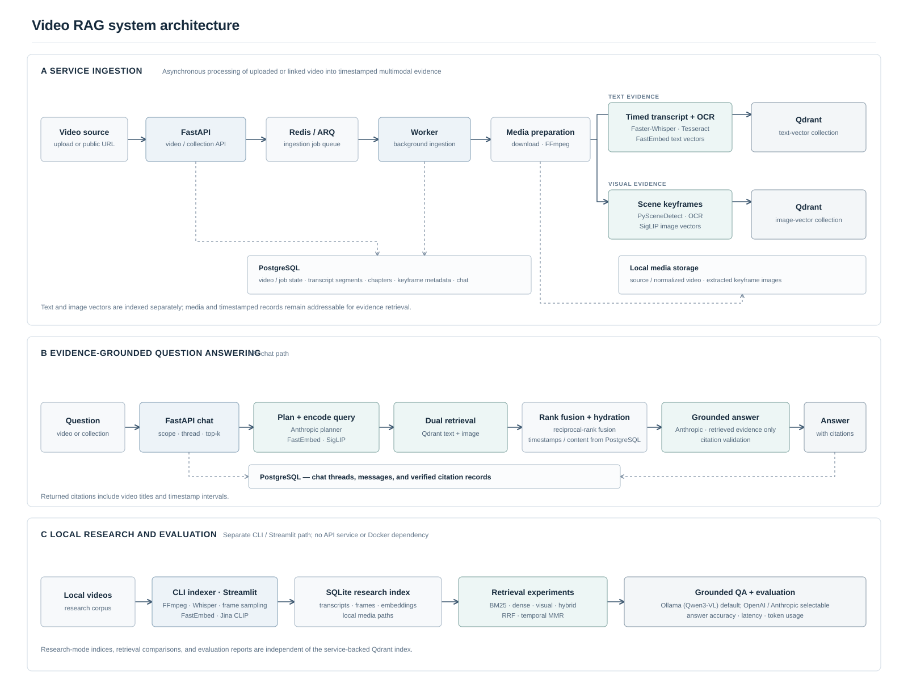

# Video RAG

[](https://github.com/anushka-naik/Video-RAG/actions/workflows/ci.yml)

Research project for finding and answering questions about moments in video. The API-backed service asynchronously indexes video into PostgreSQL and Qdrant for evidence-grounded chat; a separate local CLI and Streamlit demo compare lexical, dense, visual, and hybrid retrieval.

The service chat path uses Anthropic for query planning and answer generation. The standalone research path defaults to Qwen3-VL 8B through Ollama, with OpenAI and Anthropic also available. The project runs locally; no hosted demo is available.



## Try it

Install the project with `make install`, index a local dataset using the instructions in [evaluation](docs/evaluation.md), then start the demo with `make demo`.

Run checks with:

```sh
make test-all
make lint
make typecheck-all
```

See the short [project overview](docs/project-overview.md) for the audience, architecture, design tradeoff, and evaluation notes.
