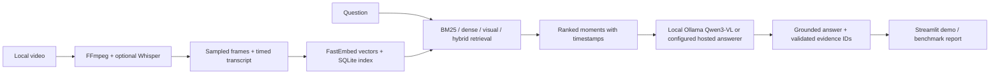

# Video RAG Research Project

This project explores question answering over video for ML practitioners and researchers who want to compare retrieval methods, inspect the moments a model uses, and run small reproducible experiments without operating a production backend. The local workflow indexes sampled frames and timed transcript chunks, retrieves candidate moments, and produces answers grounded in the selected evidence. A lightweight Streamlit demo exposes retrieval choices and timestamped evidence.

## Architecture

The research workflow is a single answer-generation call over retrieved evidence, not a multi-agent system. Its tools are FFmpeg/FFprobe for local media handling, optional faster-whisper for transcription, FastEmbed for text and image embeddings, SQLite for a portable local index, and Ollama or an explicitly configured hosted model for answer generation. The research index and answers are separate from the optional API/service stack.

## Design decision and tradeoff

The default is local indexing and inference instead of a hosted vector database and model API. This keeps experiments easy to reproduce, inspect, and run without per-request inference charges, and keeps video data on the machine. The tradeoff is that latency and supported model size depend on local hardware; users must also review each model's license. Qwen3-VL 8B is the documented local vision-language option, while provider configuration remains overridable.

## Evaluation and demo

Automated tests cover retrieval ranking and fusion, SQLite persistence, benchmark annotation parsing and scoring, citation validation, and provider adapters. The Perception Test sample is used as a small multiple-choice QA smoke benchmark. One local Qwen3-VL visual-retrieval case was run successfully; this one-case result is not a meaningful accuracy estimate. The sample does not contain question-specific evidence spans, so retrieval and citation quality cannot be scored from it. Run `make test-all`, `make lint`, and `make typecheck-all` for local checks; follow the README for indexing, evaluation, and `make demo`.

There is no hosted demo or deployed service. The demo runs locally with Ollama and the locally indexed video collection.
